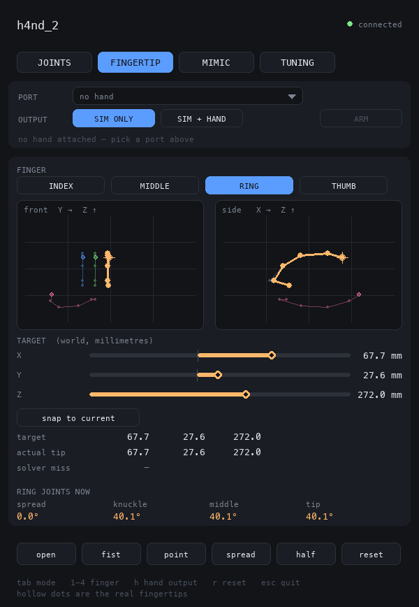
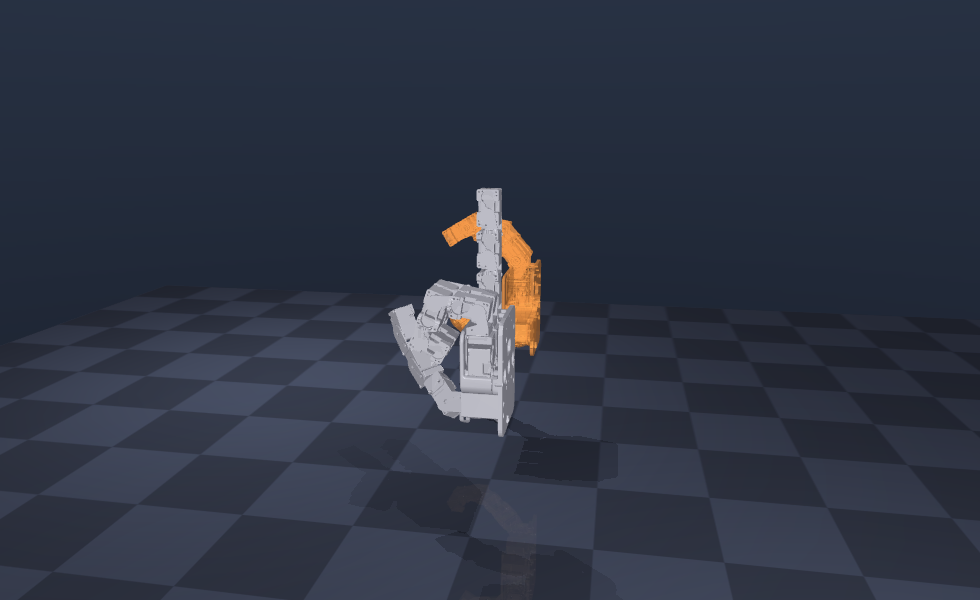
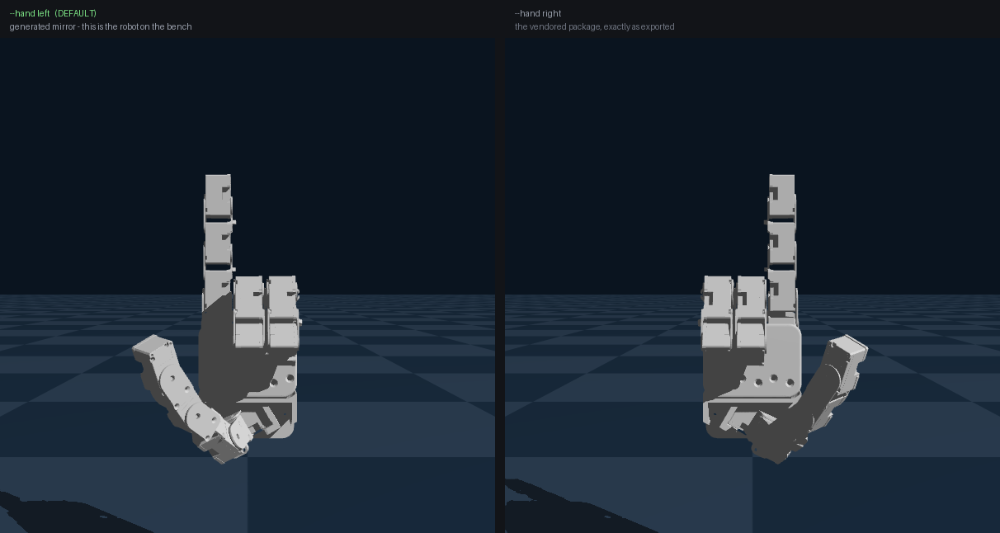
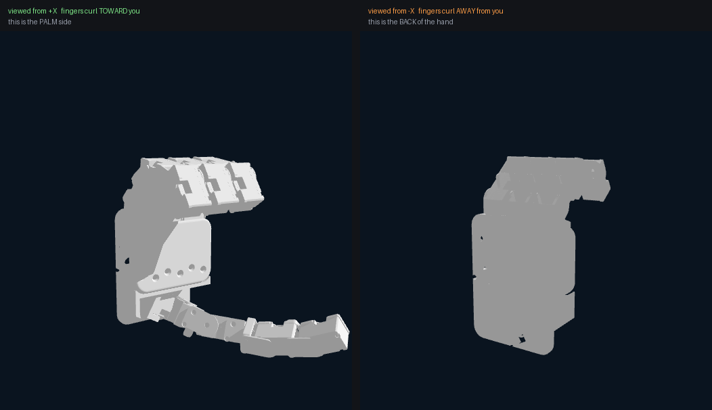
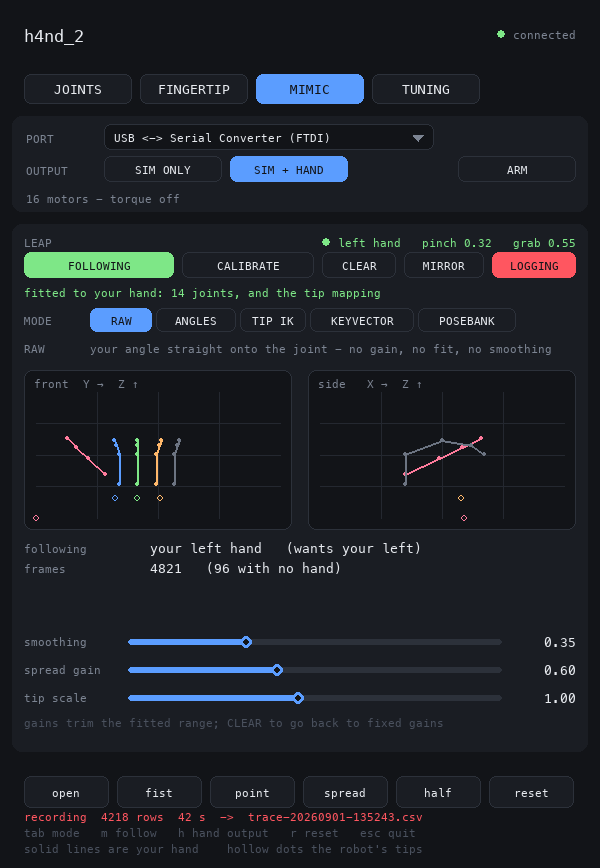
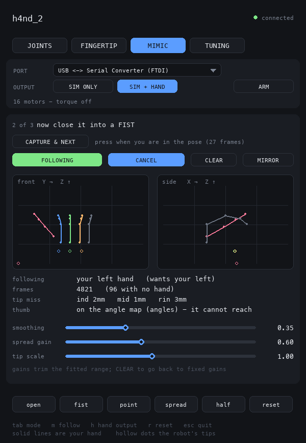
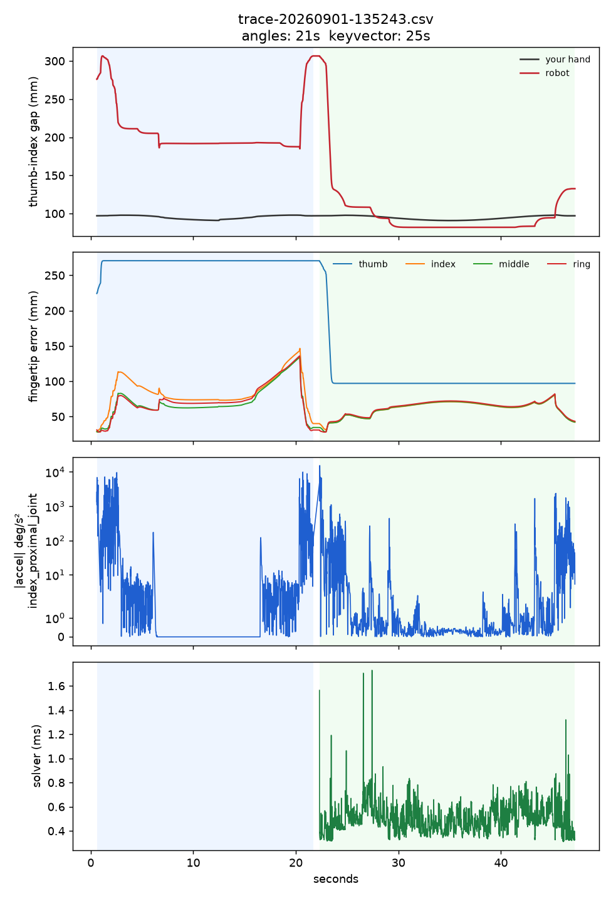

> **Archived (2026-10-20).** This is the earlier HandControl codebase, moved
> here unchanged when the work moved to [`handlab/`](../handlab/README.md).
> It still runs from this folder (`cd archive`, then the commands below, with
> `../.venv/bin/python`): it finds its files relative to itself. Paths below
> are relative to this folder. Generated files in `world/build/` hold
> absolute paths from before the move; rebuild them if they are needed.

# HandControl

Joint and fingertip control for the **h4nd** robot hand, in MuJoCo, driven
from a pygame panel.

```
.venv/bin/mjpython main.py            with the viewer
.venv/bin/python  main.py --headless  without
```

**`mjpython`, not `python`, whenever the viewer is on.** It ships inside the
venv beside `python` - same environment, same packages - and macOS requires it
because `mujoco.viewer` must own the main thread. Every `hw` subcommand and
anything `--headless` runs on plain `python`.

Two windows open: the MuJoCo viewer, and a control panel. Pick the hand from
the PORT dropdown when you want one - no flag, no restart.





Grey is the simulated hand - what you commanded. Amber and translucent is the
**real** hand, posed from its own encoders. Both are always on screen once a
port is open, so the difference between the two is the tracking error, visible
rather than inferred.

## What it does

**JOINTS tab** - one slider per joint, sixteen of them, grouped by finger and
labelled the way a hand is (spread / knuckle / middle / tip). Each track also
carries a white tick showing where the joint actually ended up, so a finger
held short of its target is visible.

**FINGERTIP tab** - pick a finger, then drag its tip around in two views (front
and side) or type it in with the X/Y/Z sliders. Both views draw the robot's own
linkage, not just its fingertips: the finger under control is bright and thick,
the other three faded back. Four bare dots said nothing about which finger a
dot belonged to or which way it was bent, and picking one of them to drag was
guesswork.

The linkage is computed in the panel by forward kinematics off the joint angles
the simulator already sends, rather than asked for over the wire - the panel
owns a `HandModel` anyway, and 24 links costs 2 ms, recomputed when a state
message lands rather than every frame. Which links to string together is read
off the chain, because the thumb runs proximal-adduction where a finger runs
adduction-proximal and a written-down list would draw the thumb inside out. mink solves the IK for that
finger, and only that finger: the solve is restricted to its own four DOFs, so
aiming the index finger cannot quietly rearrange the thumb. The panel reports
the solver's miss in millimetres - a target outside the finger's reach returns
the closest approach rather than failing, and says so.

Presets along the bottom (open / fist / point / spread / half) are hand-written
joint angles, not fitted poses.

**MIMIC tab** - leaving it switches the following off. A tab is normally just a
view, but this one is a live coupling between an operator's hand and sixteen
servos, and walking away from the view is not a reason to keep driving them -
the controls that would stop it are on the tab you just left.

**OUTPUT strip** - port dropdown, `SIM ONLY` / `SIM + HAND`, `GRIP` and `ARM`.
When a hand is attached each joint track grows a second, amber tick: the
white one is the simulated joint, the amber one is the real encoder.

## Chirality: `--hand`



`--hand left` is the default and it is the **vendored** model, read as
exported. `--hand right` is the mirror: `model.mirror_urdf()` reflects the
package through the XZ plane into `build/h4nd_right_mirrored.urdf` plus a
reflected copy of every mesh. The vendored files are only ever read.

**The label and the geometry agree, and they did not always.** `world/h4nd_left`
is modelled as the left hand directly - measured, its (forward, normal,
thumbward) triple is left-handed, which is what chirality means - so the
vendored copy IS the hand on the bench and `Retargeter.chirality()` calls each
model the hand it says it is.

The package before it (`h4nd_2`, removed - it is in git history) was a RIGHT
hand. Everything in
`model.py` measured it as one, so "left" had to mean the *mirrored* copy, and
the label and the arithmetic disagreed on purpose - because a label names the
hand on the bench, and a label that argues with the person holding the robot is
a broken label. That disagreement was written down in three places and is now
gone. `MIRRORED_FOR` says the plain thing.

Which face is the palm is the whole question, and a flat hand render is
famously ambiguous about it. Half-curl the fingers and it stops being:



What the mirror does, and why each part is needed:

| part | transform | why |
| --- | --- | --- |
| origins | `(x, y, z) -> (x, -y, z)` | the reflection itself |
| origin rpy | `R -> M R M` | still a rotation, because `det(M)^2 = 1` |
| joint axes | `a -> -M a` | an axis is a pseudovector, not a vector |
| inertia | `Ixy, Iyz` negated | the two products carrying a single y |
| meshes | reflected, winding inverted | a reflection turns every triangle inside out; uncorrected they render black and give negative volume |

The axis rule is the one that matters for everything else. Because
`M R(a, t) M = R(-M a, t)`, the mirrored joint reaches the mirrored pose at the
**same angle**. So joint names, limits, poses, recorded trajectories and
calibration signs all stay valid across the mirror - checked: every flexion
joint still curls the same way for a positive angle, and every limit is
unchanged.

## Controls are labelled by what the joint moves

Two separate things made the thumb's spread and knuckle controls read as
swapped, and both are fixed.

**Row order.** The URDF chain runs base to tip, and on the thumb that puts
`thumb_proximal` before `thumb_adduction`, where all three fingers have their
adduction joint first. Laying the panel out by walking the chain therefore gave
the thumb its first two rows the opposite way round to every finger.

**Labels.** The thumb's joint names do not describe its motion. A 0.4 rad probe
at the zero pose moves the thumb tip by:

| joint | tip motion | reads as |
| --- | --- | --- |
| `thumb_proximal` | `(+54.6, +20.5, +11.8)` mm - a swing across the palm | **spread** |
| `thumb_adduction` | `(-2.2, +3.2, +44.9)` mm - a lift along the fingers | **knuckle** |

So labelling from the names put the thumb's spread and knuckle controls on each
other's joints. `model.ROLES` labels every joint by what it moves instead, and
the panel and `hw sign --group` both read from it - `--group spread` covers
`thumb_proximal`, not `thumb_adduction`.

**This is the project's one invariant.** Anything that asks "is this a spread
or a flexion joint" goes through `model.joint_role`, never through the joint
name. `model` derives the roles, and `hardware.default_sign`,
`panel.display_chain`, `retargeting.Retargeter`, `main.hw sign --group` and
`model.set_spread_limit` all read from it - no module carries its own copy or
its own string match. The one exception is `POSES`, which is name-keyed because
those angles are hand-written for this hand rather than computed, and they were
checked against the roles afterwards.

It matters because the fingers' names happen to agree with their roles and the
thumb's do not, so a name match looks correct on three digits out of four. That
coincidence hid inverted thumb signs for three debugging rounds.

That table is written down rather than derived because the thumb cannot be
derived. All four of its axes sit obliquely - `axis . distal_axis` runs 0.68,
0.72, 0.71, 1.00, so none of them is the clean perpendicular the fingers have -
and an odd-one-out test on the tip motions splits 0.757 against 0.740, a coin
toss. The hardware settles it, and the hardware agrees with the motion rather
than the name.

Only the labelling and the layout changed. `joint_sliders` stays in joint-name
order because that order is the wire format, and every slider was re-checked
end to end afterwards: all sixteen drive their own joint and nothing else.

**The panel is a separate process.** A panel started before a change keeps the
old layout until you restart it.

### Motor IDs have the same reversal

Default IDs run 1..16 down the URDF chain, so `13 = thumb_proximal` and
`14 = thumb_adduction`. If the hand was wired spread-first throughout, those two
are the pair to exchange:

```
python main.py hw id                                  show the map
python main.py hw id --swap thumb_proximal_joint thumb_adduction_joint
python main.py hw id --joint index_middle_joint --value 7
```

Like `hw sign`, this touches no serial port - it edits the calibration file.
Nothing has confirmed the map either way; `hw watch` does.

## The three finger spread joints are not symmetric, and one control had to be

Handedness was not the only thing reading backwards. All three finger adduction
joints share a single axis, so a positive angle swings index, middle and ring
the same way through space. On the index that is spreading out; on the ring, at
the other side of the hand, the identical angle closes in. Two mechanically
identical fingers, controls that behave oppositely - and it is in the model,
not a wiring mistake.

The panel now derives, from the geometry, whether a positive angle takes each
fingertip **away** from the middle finger, and draws the slider that way up.
Index and ring both read `-20 .. +110` and both spread outward when dragged
right. The value sent to the simulator is still the true joint angle - only the
drawing is flipped, so poses, limits and calibration stay in joint terms.

Because it is derived rather than written down, it survives the mirror and any
future URDF: `model.spread_signs()`. Only joints whose motion is dominantly
sideways qualify, so the thumb's adduction, which mostly lifts, is left alone.

### The spread limits are almost certainly wrong

| joint | span |
| --- | --- |
| `index_adduction_joint` | **130°** |
| `middle_adduction_joint` | 40° |
| `ring_adduction_joint` | **130°** |

130° is the span of every flexion joint in this URDF. The three adduction
brackets and servos are identical, so index and ring look like they were given
a copied limit and the middle finger kept the real one. 110° of finger spread
is not a thing a hand does, and left in place it is what the IK reaches for:
asked for a target 90 mm to the side, it swings the index finger 34.9° sideways
and reports a 0.07 mm solve. With `--spread-limit 20` it stops at 20° and says
the target is 30 mm out of reach, which is the honest answer if 20° is true.

The real number is whatever the hardware does - `hw watch`, spread the fingers,
read the range. `--spread-limit 20` makes all three match the middle finger in
the meantime. Nothing is clamped by default, because that number is a guess
until measured.

### Not the cause

RViz versus the simulator is not it, though the package was exported for
RViz. Both are standard URDF - Z up, right-handed. The panel's own wiring is not it either: every slider was checked end to end
against the simulator, and each drives its own joint with drag-right raising
it. Worth knowing separately: the URDF's limits contradict the exporter's own
CSV on six joints (`index_proximal`, `index_middle`, `middle_middle`,
`middle_distal`, `thumb_middle`, `thumb_distal` read `[-20, +110]` where the
CSV says `[-110, +20]`, with identical axes), so someone normalised them by
hand after export. The axes are consistent, so this flips nothing - but it is
more evidence that the limits in this file are a human decision rather than a
measurement.

## The hand will not go through itself

Every joint command passes `HandSim.command`, and that is where poses which put
the hand inside itself are refused - sliders, presets, fingertip IK and the Leap
mimic all arrive by the same door. What reaches the motors is the refused
version too: the loop sends `sim.targets`, not the target it asked for, because
the real hand has more to lose by a collision than the picture does.

The simulator alone cannot do this job. MuJoCo resolves self-contact and mink
steers the IK around the hand's own fingers, so neither is the gap it once
was - but a contact only pushes back in the SIMULATOR. The real hand has no
physics to save it: the same joint targets go down the bus to sixteen servos
that will simply pull. So `collide.py` checks geometrically, against the same
meshes, with two decisions that make the answer mean something here:

**Penetration depth, not distance.** Adjacent fingers abut at 0.00 mm on an
open hand - measured on the raw meshes, not the convex hulls, which inflate the
interlocking brackets until even a rest pose reads as contact. Any
distance-based rule therefore forbids the hand from existing. Depth separates
cleanly.

**A per-pair baseline.** Each pair's depth at the neutral pose is measured once
and subtracted, so what gets reported is how much deeper than as-built a pose
has driven that pair. A pair that ships 0.8 mm inside itself starts at zero
like every other.

Pairs are chosen, not listed: two links are worth checking when at least one
movable joint lies between them, which drops the palm against the finger mounts
(rigidly connected, so their separation is a constant) and every parent-child
pair sharing a joint. Same-digit pairs go too - the export overlaps them along
the whole chain and the limits do not let a finger reach itself. 160 pairs
survive, with an AABB broadphase in front of them.

### Where the threshold came from

Contact is not the enemy. A hand that cannot touch itself cannot pinch or grip.
Passing *through* is. The margin sits in the gap between the two, measured:

| pose | depth past as-built | |
| --- | --- | --- |
| open hand, worst pair | 0.80 mm | baselines to 0 |
| three fingers curled to 80 deg | 0.07 mm | allowed |
| `fist` preset, thumb on index | 2.82 mm | **must be allowed** |
| thumb/index pinch, tips 0.6 mm apart | 3.90 mm | **must be allowed** |
| index swung 17 deg into its neighbour | 7.72 mm | **must be refused** |
| fingers to 100 deg, tips into the palm | 11.30 mm | **must be refused** |

`MARGIN = 6 mm` sits in the middle of that gap with 2.1 mm of headroom either
side. All six cases come out as intended.

### What it costs, and how to turn it off

A refused target is not an error - the hand travels as far along the way as it
can and stops. Asking for index spread -34 degrees gets you -3.6. (`blocked`
rides along in the state message; nothing in the panel draws it yet, so what
you see is the slider settling short of where you put it.)

One check is 1.8 ms over 160 pairs; a clear target costs exactly that, and only
a genuine collision pays for the seven-step bisection that finds the boundary.
Repeated calls with an unchanged target are free, which matters because the loop
issues one every step. Measured end to end: 384 Hz with the checker in the path
against 834 Hz without, both far above the 100 Hz the simulation runs at.

`--allow-collisions` turns it off. `collide.MARGIN` tightens it.

## Why MuJoCo, and what it cost

This ran on Genesis first. The move was measured on this hand, not chosen on
taste:

| | Genesis | MuJoCo |
| --- | --- | --- |
| step cost | 1.2 ms | **~0.02 ms** |
| rise to 90% | 0.26 s | **0.10 s** |
| torque needed for that | 5 Nm - ten times the real servo | **0.5 Nm, the real stall** |
| IK per frame | 9.2 ms, worst 1005 | **1.4 ms, worst 2.1** |
| IK joint jitter | 6.85 deg/frame, worst 54 | **0.78 deg/frame, worst 1.5** |
| IK and collisions | none: 11.2 mm penetration | **avoids: 0.17 mm** |
| self-collision physics | unusable | **works** |
| install | 2.8 GB | **524 MB** |

The jitter and the 1005 ms spike are one fault: Genesis restarts its IK from
random seeds when it struggles, so it lands on a *different valid branch*
between frames. mink is differential - it starts from where the hand is and
takes the shortest joint-space step - so smoothness is structural rather than
tuned.

Three things had to be built, and all three were load-bearing:

**`armature` on every joint.** Without it MuJoCo diverges at REST, with
contacts disabled, inside 4 ms - the links weigh 9 grams with inertias near
1e-6 and no stiff position actuator can hold one. It is also the honest model:
a 288:1 XL330 reflects far more rotor inertia to the joint than the link has.

**`<contact><exclude>` on the eight body pairs that ship interpenetrating.**
The SolidWorks export overlaps neighbouring links 19-25 mm deep around their
shared joints. This is the same defect that made Genesis's self-collision
unusable; MuJoCo can simply be told to ignore those pairs and collide normally
everywhere else. Which pairs is found by asking the model at its neutral pose,
never listed.

**Fingertip sites.** MuJoCo's URDF importer fuses fixed joints, which deletes
the `<finger>_tip_link` frames the IK exists to aim at - a distal link's own
origin sits on its joint axis and does not move when that joint rotates. They
come back as MuJoCo sites, read off the same generated URDF.

Gains do not travel between engines. The Genesis values (kp 40, kv 4, clip 5)
give +20 degrees of overshoot here.

## Making it faster

Five rate limits sit between a Leap frame and a moving finger, and the tightest
one is not in this repo:

| | limit | |
| --- | --- | --- |
| `retarget.smoothing` | 0.35 blend at 60 Hz | ~48 ms to 63% |
| `retarget.max_rate` | 6.00 rad/s | 344 deg/s |
| `hardware.MAX_SPEED` | 1.50 rad/s | 86 deg/s |
| write rate | 50 Hz | |
| **servo `profile_velocity`** | **200** | **275 deg/s** - was 40, and was the binding one |

At the old default of 40 that was 55 deg/s, and a 90 degree finger close took
**1.64 s** - the single biggest reason the hand felt slow, and a register on the
motor rather than anything in this repo. The defaults now ship fast: 200
(275 deg/s, so 0.33 s for that same close) and 100 Hz writes, with `MAX_SPEED`
DERIVED from that profile rather than written down - `profile_rad_s()` makes it
4.80 rad/s, where it used to be a hardcoded 6.0 that let the command outrun the
hand by a quarter on every large move. `hw gains --profile-velocity 40` puts
the gentle version back, and since `write_gains` now records what it wrote,
that survives the next arm instead of being reverted by `configure`.

Then the simulator, which has its own 0.73 s rise for a different reason: its
torque clip is the XL330's 0.5 Nm, so a slider-sized step saturates and the
whole move is spent at the limit. Measured on a 0 -> 57.3 degree step:

| clip | kp | kv | overshoot | rise to 90% |
| --- | --- | --- | --- | --- |
| 0.5 Nm | 12 | 3 | +0.06 deg | 0.73 s |
| 2.0 Nm | 12 | 3 | +0.06 deg | 0.59 s |
| 5.0 Nm | 40 | 3 | +2.88 deg | 0.22 s |
| **5.0 Nm** | **40** | **4** | **+0.01 deg** | **0.26 s** |
| 5.0 Nm | 80 | 4 | +15.35 deg | 0.20 s |

`clip 0.5, kp 30, kv 1.0` is what ships, and it needs no fudge: under MuJoCo
the XL330's real 0.5 Nm stall reaches 90% of a 57 degree step in 0.10 s. The
old `clip 5.0, kp 40, kv 4` was a Genesis-era workaround - a simulated hand ten
times stronger than the real one - and those numbers do not travel between
engines. See `model.py` for the measured table.

### The TUNING tab

Everything above is a slider in the panel's fourth tab, adjustable while the
hand is being held. Nothing needs a restart and nothing needs the torque
dropped: MuJoCo takes controller gains at any time, the stream rates are
numbers the bus thread reads next tick, and the servo fields are RAM registers
on the XL330 rather than EEPROM.

| group | fields |
| --- | --- |
| SIMULATOR | stiffness, damping, torque clip, collision margin |
| IK SOLVER | damping, iterations, tolerance |
| COMMAND STREAM | slew rad/s, writes per second |
| SERVO | P, I, D, profile velocity, profile acceleration, current limit |

**`IK AVOIDS FINGERS` / `IK IGNORES FINGERS`** toggles the solver's collision
term. Green means mink steers around the hand's own fingers; amber means it
does not. Measured, sending the index tip onto the middle finger:

| | tip miss | penetration |
| --- | --- | --- |
| avoiding | 19.98 mm | 0.69 mm |
| ignoring | **0.26 mm** | **9.28 mm** |

Ignoring does NOT let the hand pass through itself. `sim.command` still clamps
whatever the solver returns, so the finger drives at its neighbour and stops
dead at the margin - 4.51 mm, `blocked=True` - instead of finding a way round.
The toggle is there to show what the collision term is buying, and for the case
where you would rather have the reach and take the stop.

The IK group moves what the solver is given. Restarts buy escapes from
local minima, iterations buy precision, damping trades convergence speed for
steadiness near a singularity. They were literals in `solve_tip`'s signature -
invisible, and unreachable from a running session, which is exactly when a
fingertip target turns out to converge slowly or jitter between solutions.

### A preference file must not outvote the program

The panel remembers where the sliders were in `config/panel_settings.json`, and
that file quietly undid a retune: the shipped gains were changed in the code,
and every launch put the old slow numbers back from disk - a change that
appeared to have been made and had not been, with nothing on screen to say so.

Two things now stop that. `DEFAULTS["tuning"]` is imported from the modules
that own those numbers rather than copied beside them, so there is only one
place to change. And the file carries a `tuning_version`: a stored block
written against different defaults is DISCARDED, the shipped values are used,
and the panel says so. A preference file may remember what you chose; it must
not outvote the program about what it ships.

**Changes stick.** Every slider you move is written to
`config/panel_settings.json` and pushed back to the simulator on the next run.
**RESTORE DEFAULTS** puts the whole tab back to what ships - on screen, in the
running simulator, and on disk, in one click.

The software defaults come from `settings.DEFAULTS["tuning"]`, which is itself
imported from the modules that own those numbers, so a default is still written
down in exactly one place. The SERVO defaults are deliberately NOT in that file:
restoring them writes RAM registers on sixteen motors, which is a fine answer to
a button press and not a fine thing for a file to do at launch.

Values are read back out of the running session rather than remembered by the
panel, so a slider cannot drift out of step with what is actually applied - and
a slider being dragged is left alone while that is happening. One field goes
per message, so a drag does not rewrite eleven registers nobody touched.

The ranges are deliberately not unbounded: `current_limit` stops at 900 mA,
well under what sixteen XL330s will draw, and the collision check cannot be
switched off from here at all - that needs `--allow-collisions` on the command
line. A tuning panel should not be able to disarm a safety interlock by
accident.

### Seeing less of the hand inside itself

The margin allows 6 mm of penetration past as-built so the hand can pinch, and
that allowance is what is visible in the viewer. MuJoCo is not pushing it apart
either: the eight body pairs that ship interpenetrating are excluded from
contact at build time, and neighbouring fingers are among them. Tightening the
margin tightens what you see:

| margin | fist | crossed fingers |
| --- | --- | --- |
| 6 mm | allowed | refused |
| 4 mm | allowed | refused |
| **3 mm** | **allowed** | **refused** |
| 2 mm | refused | refused |

`--collision-margin 0.003` halves the visible overlap and still pinches. Below
that the hand can no longer touch itself at all. Removing the overlap entirely
means replacing the collision meshes, which is also the only way those eight
`<exclude>` pairs would stop being needed.

## Why nothing moves until you say so

Three clicks, in this order, and none of them happen on their own:

1. **PORT** - pick the U2D2 from the dropdown. The amber hand starts mirroring
   the encoders immediately. Nothing is being commanded yet.
2. **SIM + HAND** - joint commands now go down the bus. Still nothing moves:
   the motors are not energised.
3. **ARM** - torque on. *Now* the fingers follow.

**GRIP** is the fourth, optional, and it is what makes holding a thing work
without the mapping knowing there is a thing: closing to contact. The
mapping keeps sending "close"; the bus thread watches the encoders and the
present current, and a finger told to keep closing that stops moving - it
has met the object, or the palm - is held where it stalled plus a small
squeeze, which the current limit turns into a grip force. When the operator
opens past that point it follows again. Per finger, on the flexion joints
only, no model of the object anywhere (`handcontrol/executor.py`). The
button reads `HOLD IND MID` while fingers are held. The thresholds are set
from the servo's own numbers and have not yet met a bench.

Step 1 on its own is genuinely useful: with the hand limp, push the fingers
around and watch the amber hand copy them. If a joint bends the wrong way in
the viewer, its `sign` in the calibration is wrong, and that is far better
found this way than by commanding it.

## The real hand

Choose the port from the dropdown at the top of the panel. It lists the USB
serial bridges that are actually plugged in - macOS advertises a Bluetooth
port and a debug console too, and both open happily and answer nothing, so
neither is offered. Two entries always are: `mock link (no motors)`, which
exercises the whole hardware path with no bus behind it, and `no hand`, which
disconnects. The list is re-read every time the menu opens, so plugging the
U2D2 in after starting the panel is fine.

Selecting a port makes the hand *available*. Two further switches, both off
until you throw them, decide whether anything happens to it:

| state | means |
| --- | --- |
| available | a port is selected and the bus answered |
| enabled | `SIM + HAND`: joint commands are being sent down the bus |
| armed | `ARM`: the motors are energised and will act on them |
| grip | `GRIP`: fingers that stall against something are held there, plus a squeeze |

Arming is click-only, never a keystroke - a stray key is not consent to
energise sixteen servos. While armed the strip turns red and says so.

Commands are rate-limited twice over: the servos get a velocity profile
(`--max-speed`, 6.0 rad/s by default, enforced in software), and a current
limit (`--current-ma`, 300 mA) that stops a finger which has hit something
from pulling until a linkage gives.

Bus-level commands, none of which need the simulator:

```
python main.py hw scan   --port PORT    what is on the bus       (reads only)
python main.py hw status --port PORT    volts, current, temp     (reads only)
python main.py hw watch  --port PORT    live angles as you bend it (reads only)
python main.py hw zero   --port PORT    call this pose zero      (writes the calibration file)
python main.py hw hold   --port PORT    energise, without moving
python main.py hw relax  --port PORT    torque off - the hand goes limp
```

### What the bus actually looks like

Measured, not assumed - all of it is baked into `handcontrol/hardware.py`:

* **4 Mbaud.** Nothing answers at 57600, 115200, 1M or 2M.
* **Sixteen XL330-M288** (model 1200), IDs 1..16, none missing.
* **Single reads drop at this rate.** ID 13 answered a ping and then failed
  eleven consecutive one-byte reads. Every transaction retries five times;
  without that the bus looks like it has holes in it, which reads as a wiring
  fault and sends someone hunting for a broken cable.
* **Reading all sixteen encoders costs 16 ms**, and that is the macOS FTDI
  latency floor, not wire time - dropping the SDK's latency timer below it does
  return sooner, but only by truncating replies (13 clean reads out of 25 at
  4 ms, 9 at 2 ms). So the bus gets its own thread: the simulation hands over a
  target and reads back the last encoder frame, and never waits. Measured 734
  Hz in the sim loop with the bus polling alongside it.
* Operating **mode 5**, current-based position control, 300 mA limit. Torque
  may or may not be on when you connect - these motors were found energised
  once and idle after a power cycle, since Startup Configuration is 0. The
  panel reads the real torque bit on connect rather than assuming either.
* After a power cycle, Goal Position comes up equal to Present Position. That
  is worth knowing when torque turns out to be off unexpectedly: goals that
  all match the present position mean the hand rebooted, where a software
  `torque_enable = 0` would have left the old goals behind.
* **Profile velocity reads back as 0** - a goal change is a step, not a move.
  Arming writes a profile velocity, and the loop rate-limits on top of it.

### The flexion actuators are mounted backwards

Twelve of the sixteen - every joint whose role is not `spread` - turn the
opposite way to the URDF's convention: the model has a positive angle curl the
finger toward the palm, and on this build the servo does that for a *negative*
tick delta. The four spread joints are mounted the way the model expects. That
is a property of how the hand was assembled, so it lives in
`config/hand_calibration.json` as `sign: -1`, and it is the default from
`hardware.default_sign`.

**By role, not by name**, and that distinction cost a debugging round. An
earlier version split the groups on whether `adduction` appeared in the joint
name, which put `thumb_proximal` (a spread) into the flexion group and left
`thumb_adduction` (a flexion) out of it. Both ended up inverted, so the thumb's
two joints drove the hardware backwards while the simulator and the sliders
looked perfectly normal - because nothing in the model was wrong. If the
hardware disagrees with the screen on exactly one digit, this is the first
thing to check:

```
python main.py hw sign --group spread  --value 1
python main.py hw sign --group flexion --value -1
```

The URDF would be the wrong place to fix it. The URDF describes the mechanism,
and the mechanism is fine; flipping axes there would silently invalidate every
pose, limit and IK result already written in joint terms, and would leave the
simulator disagreeing with a hand that is not actually built wrong. The sign
changes only the tick conversion, which is the single thing that is wrong.

Flip a group or one joint:

```
python main.py hw sign --group flexion --value -1     # the twelve, together
python main.py hw sign --group spread  --value -1
python main.py hw sign --joint index_proximal_joint --value 1
```

`hw sign` touches no serial port - it edits the calibration file, and only
lives under `hw` because it describes hardware.

### When a joint oscillates, it wants damping, not stiffness

Both controllers here are POSITION controllers with a hard ceiling on effort,
and that shape is the whole reason a slider step rings. In simulation it is a
PD loop clipped at `EFFORT`; on the hand it is DYNAMIXEL operating mode 5,
current-based position control, clipped at `--current-ma`. Neither is torque
control.

A slider-sized step asks for far more than the clip allows - `KP * 1 rad` is
12 Nm against a 0.5 Nm ceiling - so the joint spends the whole travel
saturated and arrives carrying speed. Only damping sheds that. Measured in
simulation on a 0 -> 57.3 degree step of `index_proximal`:

| KP | KV | overshoot | rise to 90% |
| --- | --- | --- | --- |
| 12 | 0.35 | chatters, never settles | - |
| 12 | 1.0 | +33.2 deg | 0.60 s |
| **12** | **3.0** | **+0.1 deg** | **0.73 s** |
| 30 | 3.0 | +29.0 deg | 0.62 s |
| 30 | 6.0 | +8.0 deg | 0.69 s |
| 60 | 6.0 | +29.8 deg | 0.64 s |

Raising KP makes it worse every time: more stiffness only saturates the clip
harder and arrives faster. Rate limiting the command does nothing either, since
the joint is slower than any sane slew rate. `KV = 3.0` is what ships, and it
takes the overshoot to 0.06 degrees with no residual ring, at the cost of 0.13 s
of rise time.

The same argument applies to the hand, with one extra term: its D is
differentiated from a 0.088 deg/tick encoder, so too much of it turns
quantisation into audible buzz. Read and set the gains live - they are RAM
registers, so this works with torque on:

```
python main.py hw gains --port PORT                       read all 16
python main.py hw gains --port PORT --position-d 300
python main.py hw gains --port PORT --profile-acceleration 20
```

And measure rather than guess. `hw step` arms the hand, moves one joint a small
amount, records where it went, and puts it back:

```
python main.py hw step --port PORT --joint index_proximal_joint --degrees 15
```

It reports overshoot as a fraction of travel and the peak-to-peak ring once
settled, then says which way to go: overshooting wants more `position_d`,
buzzing at rest wants less.

The gains are written on every `ARM`. They did not used to be - `configure`
set the mode, the current limit and the profile but never the PID - so the
hand's feel came from whatever was last left in its EEPROM, invisible from
here and different on every hand. The shipped values are what was found on the
bench hand (P=250, I=0, D=600), not the XL330 factory values (P=900, I=0,
D=0), so nothing changes today; they are there to be changed.

### Calibrate before you arm

The joint-to-motor map and the zero ticks are **not yet known for this hand**.
`config/hand_calibration.json` starts as a guess: IDs 1..16 in joint order,
zero at tick 2048, sign +1. Reading the hand through that guess gives mostly
small plausible angles, but `thumb_middle_joint` comes out at -89 degrees,
which is either a real pose or a wrong mapping - the file cannot tell you
which.

So, before commanding anything:

1. `hw relax`, and put the hand in the URDF zero pose by hand - fingers
   straight out, thumb out to the side (`python main.py pose open` shows it).
   The joints hold their position unpowered, so nothing collapses.
2. `hw zero` - the current ticks become the zeros.
3. `hw watch`, then bend one joint at a time. The bars show movement since
   start, so a joint that runs the opposite way to the finger needs its sign
   flipped. The twelve flexion joints are already at -1; confirm rather than
   assume. The amber hand in the viewer shows the same thing in three
   dimensions.
4. Only then `ARM`.

## Command line

```
python main.py                          viewer + panel
python main.py --no-panel               viewer only
python main.py --headless               no viewer at all
python main.py panel                    panel only (the simulator spawns this)
python main.py ik index 0.02 0.03 0.30  solve one fingertip, print the angles
python main.py pose fist                hold a named pose
python main.py poses                    list the named poses
```

Common flags: `--position X Y Z` (where the palm is bolted, default
`0 0 0.20`), `--no-gravity`, `--no-self-collision`.

Model flags: `--hand left` (default: the vendored model, which is the hand on
the bench) or `--hand right` (a generated mirror of it);
`--spread-limit DEG` to clamp the finger adduction joints symmetrically.

Viewer flags: `--no-ghost` (drop the encoder hand), `--ghost-offset` (how far
to the side it sits, default 0.24 m; `0` overlays it on the simulated one). The
encoder hand is placed on the side the thumb is not on.

Hardware flags: `--port`, `--baud` (default 4000000), `--current-ma` (300),
`--max-speed` (6.0 rad/s), `--mock-hardware` (exercise the hardware path with
no bus behind it). `--port` still works as a preselect; the dropdown is the
normal way in.

## Mimicking a hand: the MIMIC tab

```
python main.py --port /dev/cu.usbserial-FT8J0X9Y --hand left
```

then click **MIMIC**, then **FOLLOW MY HAND**, then **CALIBRATE** and follow
the three prompts. **KEYVECTOR** on the MODE row is the mapping to use; the
one `.venv` below carries it. Your hand is drawn in the MuJoCo
viewer above the robot's, and in the panel's two pad views on top of the
robot's fingertips.

Two placements of one transform, on purpose. In the viewer you are comparing
two shapes, so they have to be two shapes - superimposed they interpenetrate
and neither is readable. In the pads they are superimposed, and there that is
the point: a hand sitting off to one side of the dots is a mapping that is off
to one side. `--skeleton-offset X Y Z` moves the viewer copy; `0 0 0` puts it
back on the robot.



`--mimic` starts it following immediately; `--mimic-mode tip`, `--mimic-thumb
pinch`, `--follow left` and `--tracking-mode` preset the tab.

**Where the Leap lives, and why.** In the simulator's process, not the panel's.
The IK belongs to whoever owns the MuJoCo model, the skeleton has to be drawn
in that same scene, and the panel already receives a state message twenty times
a second - so the hand travels the direction the data already flows and the
panel stays what it is on every other tab: a control surface that sends
requests and draws what comes back. The tab's buttons are set from what the
simulator reports, never from the click that asked, exactly as the PORT
dropdown is.

```
      Leap Motion                              panel process
           |                                         |
    handcontrol/leap.py                         MIMIC tab
    (libLeapC via ctypes)                            |
           |                                  {mimic, calibrate}
    retargeting/filters.py                           |  UDP :9870
    (one euro, spike gate)                           v
           |                        ------- main.py run loop -------
    retargeting/retargeter.py  -->  targets -> sim.command()
    (angles, tips, skeleton)                -> hardware.command()
           |                                -> sim.draw_debug(skeleton)
    retargeting/keyvector.py                -> {state, leap, skeleton}
    (MANO-21 keypoints)                        UDP :9871 back to the panel
           |
    retargeting/bridge.py  --- UDP :9872/:9873 --->  keyvector_bridge.py
    (async, never waits)                             (.venv-dex: pinocchio,
                                                      nlopt, torch, numpy 2)
```

`leap_mimic.py` is the same machinery with no panel and no UDP hop - one flag
per setting, plus `--print`, which needs no simulator and is the fastest way to
see whether the retargeting is sane. Both drive `handcontrol/mimic.py`.

```
python leap_mimic.py --print             angles in the terminal, no simulator
python leap_mimic.py --mode tip          viewer, through the fingertip IK
python leap_mimic.py --udp               drive a main.py that is already up
```

**MIMIC overrides the other tabs while it is on.** The run loop writes
`targets` from the operator's hand after draining the message queue, so the
sliders and the fingertip pads still move but nothing downstream reads them.
Switch it off and the hand stays exactly where you left it, under whichever tab
you go to next.

### The binding is ours, because the SDK's does not fit

The SDK's Python binding is a compiled `_leapc_cffi` for CPython 3.12 and this
project runs 3.11, so `handcontrol/leap.py` binds `libLeapC.dylib` with ctypes:
no compiler, no wheel, no version to keep in step. Two things it has to get
right, both of which fail silently rather than loudly:

- The header wraps itself in `#pragma pack(1)`, so every struct is byte-packed.
  Miss it and `LEAP_HAND` is 1088 bytes instead of 1084, and every float past
  the first few is read out of the middle of another one.
- `LeapCreateConnection` rejects a filled-in `LEAP_CONNECTION_CONFIG` with
  `eLeapRS_InvalidArgument` whatever `size` says. NULL means "default
  configuration", which is what this wants anyway, so the struct is not
  declared at all.

The sizes are asserted at import, and the SDK stamps its own struct size into
every message - that is checked before anything is dereferenced, and it is what
caught the packing in the first place.

The Ultraleap Control Panel can run at the same time (`Client count: 2`), and
is worth having open once: it shows your hand, where this shows what the robot
does with it.

### The mapping is a resemblance, not a measurement

Three fingers and a thumb against a human five; sixteen joints against a human
twenty-odd; limits of [-20, 110] degrees that no knuckle obeys.
`handcontrol/retargeting/` measures angles off the operator - flexion in the
plane containing the bone and the palm normal, spread in the palm plane - and
decides which robot joint each one drives. It addresses joints by *role*
(`model.joint_role`), never by name, because `thumb_proximal_joint` swings the
thumb across the palm where `index_proximal_joint` is a knuckle.

Which way the robot's palm faces, which side its thumb is on, and which sign of
a spread joint means "outward" are all measured off the URDF at startup, so
`--hand right` retargets correctly without a second table to keep in step.

There are five mappings on the MODE row, and they fail differently. Two of
them - KEYVECTOR and STUDENT - also have a tab of their own; see LEARNING
below.

**ANGLES** drives each robot joint from the matching human angle. It always
answers and never surprises, and it puts fingertips approximately nowhere - the
segments are not the same lengths, so equal angles do not put tips in equal
places, and the error compounds down the chain.

**TIP IK** maps the fingertips into the robot's palm frame and hands them to
`sim.solve_tip`. The OPEN capture fits one scale and one translation to the
three fingers, least squares. Without that fit the operator's tips are measured
from the middle of the palm and the robot's from the base of its palm link, so
a flat hand lands 30 mm short and a finger-width inside the palm, and the IK
spends its range correcting a constant. Fitted, the three fingers land within
0.2 mm of the robot's own neutral pose. The **tip miss** row is the honest
part: an unreachable target does not fail, it comes back as the closest
approach.

**KEYVECTOR** is the default, and the one to use. It matches the vectors
*between* fingertips rather than the angles or the positions, which is the fix
for both of the above - see below.

The solver is started on the first frame that needs it, not when the mode is
selected, so a session that never presses FOLLOW pays nothing for it. With
`dex_retargeting` missing it reports that once, latches, and the hand keeps
following on the angle mapping - a missing solver costs you the better mapping,
not the session.

### KEYVECTOR: matching relations, not poses

Angles transfer badly because the segments differ. Absolute positions transfer
badly because the robot's thumb cannot reach where a human thumb goes.
Differences of positions survive both, and a pinch is a difference.

For a four-fingered hand there are **10 keyvectors**: six between fingertip
pairs, four from the wrist to each tip. Retargeting is then one nonlinear
least-squares solve over all sixteen joints, with a term penalising change from
the previous frame. Because only differences are matched, the workspace
mismatch that strands the thumb stops being an error to minimise and becomes an
offset the solver absorbs.

The part that makes it work in practice is hysteretic pinch projection: when a
human thumb-finger distance drops below 3 cm the target for that vector is
replaced by a near-zero vector and its weight jumps from 1 to 200, snapping the
robot fingertips into contact. It releases at 5 cm, so it cannot chatter.

    Handa et al., DexPilot (2020); Qin et al., AnyTeleop (RSS 2023).
    Solver: dexsuite/dex-retargeting, MIT.

### Fingers hook instead of curling, unless you constrain orientation

A finger has four joints; a fingertip has three coordinates. Matching tip
POSITION therefore leaves one degree of freedom per finger unconstrained, and
the solver spends it however it likes. Measured on a real recording, it liked a
hook:

| | your DIP | robot DIP |
| --- | --- | --- |
| index | 7 deg | **106 deg** |
| middle | 3 deg | **97 deg** |
| ring | 9 deg | **94 deg** |

Same fingertip position, opposite posture - your fingers curl at the knuckle,
the robot's folded at the tip and straightened the knuckle to compensate.

Two things make it stick. The distal joint has six times less authority over
the tip than the spread joint (4.7 mm against 29.2 for the same 0.2 rad), so it
barely registers in a least-squares objective; and `dex_retargeting` starts
every joint at its limit MIDPOINT, which for a [-20, 110] joint is +45 degrees -
already curled, with nothing to pull it back.

The fix is the **DIP-to-fingertip vector**, from *Analyzing Key Objectives in
Human-to-Robot Retargeting* (2025), which weights it at 10 and reports that
removing it makes "fingers bend in the wrong direction". That vector is the
last bone's direction, so constraining it constrains exactly the posture the
position term leaves free. `keyvector_bridge.oriented()` appends four of them,
taking the hand from 10 keyvectors to 14, and starts the solve at the open hand
rather than the midpoint.

It costs about 1.3 ms per solve instead of 0.5, and it frees the joint: on a
knuckle-led curl the distal joint travels 61 degrees and reaches -10, where
before it never came below 76. `--no-orientation` and `--midpoint-init` on the
bridge restore the old behaviour for comparison.

**The thumb is in it, and is where most of the gain is.** It appears in three
of the six pairwise vectors and in its own wrist vector, and all four of its
joints are solved. The `--tip-thumb` exclusion applies only to TIP IK, where
absolute positions strand it; nothing here ever asks the thumb for an absolute
position. On a synthetic sweep with the thumb opposing and closing:

| thumb | angles | keyvector |
| --- | --- | --- |
| `thumb_proximal` travel | 0.0 .. 57.4 deg | 1.4 .. **95.0 deg** |
| `thumb_adduction` travel | -0.0 .. 39.9 deg | 1.4 .. **78.1 deg** |
| tip error | 113.6 mm | **37.6 mm** |
| pinch aperture error | 69.0 mm | **35.9 mm** |

It is not only more accurate, it uses the travel the hand has. The angle
mapping leaves the last two thumb joints essentially idle; the solver spends
them placing the tip.

**It runs in a separate process, and only sometimes a separate interpreter.**
`dex_retargeting` pulls in Pinocchio, NLopt and torch and wants `numpy >= 2`.
That used to conflict with this project's environment, which sat on numpy 1.26
alongside Genesis, so the solver got a venv of its own. Nothing in the tree
caps numpy below 2 any more - the only upper bound anywhere is scipy's
`numpy<2.7` - so **one environment now holds both halves**:

```
python3.11 -m venv .venv
.venv/bin/pip install mujoco mink trimesh python-fcl pygame \
    dynamixel-sdk pyserial matplotlib scipy dex_retargeting torch
```

`bridge.solver_python` picks the interpreter: a `.venv-dex` if the project has
one, and otherwise the interpreter already running. Keep the split only if
something else pins your environment below numpy 2:

```
python3.11 -m venv .venv-dex
.venv-dex/bin/pip install dex_retargeting torch
```

Either way the solver stays a separate PROCESS. That is not about
dependencies: a blocking solve would put the solver's worst case straight into
the simulation loop, and a solver that stalled would stop the hand rather than
merely date it. Same argument as the pygame panel, same transport.

Then pick KEYVECTOR on the MIMIC tab. The solver starts on demand, takes a few
seconds to load the URDF, and stops when you leave the mode. Until it answers,
the hand keeps following on the angle mapping rather than freezing. Measured
here: **0.5-0.9 ms per solve** once warm, against a 10 ms frame.

Nothing needs writing for it. Your URDF already carries everything it asks for -
the generated `<finger>_tip_link` frames and `palm_base_link` as the wrist - and
the joint order, tip links and size ratio are passed to the solver at startup by
`main.py`, so there is no config file free to drift out of step with the code.

**A pre-existing hand model will not substitute for yours.** The solver emits
joint angles for whatever hand the URDF describes; load an Allegro and you get
sixteen numbers that are correct for an Allegro and meaningless to these
XL330s. The hands shipped with `dex-retargeting` (allegro, shadow, leap,
inspire, ability, schunk) are worth running once to prove the pipeline before
trusting your own URDF, and that is all.

### Which hand to hold over the sensor

**A left robot wants your left hand.** Hold up the other one and it still
tracks, the mapping is still anatomical - your index is its index, spreading
outward still spreads outward - but two hands of opposite chirality cannot also
agree about direction in the room, so the robot appears to move the wrong way.
The tab says so in red when it happens.

Which hand the robot is comes out of the geometry, not the `--hand` label:
`(forward, normal, thumbward)` is a right-handed triple for a right hand and a
left-handed one for a left hand, so the sign of its determinant settles it -
for the operator and the robot alike, with no table to keep in step. That
matters here more than usual, because `MIRRORED_FOR` records that the `--hand`
label and the geometry disagree on purpose.

| | `--hand left` (default) | `--hand right` |
| --- | --- | --- |
| the robot is a | left hand | right hand |
| hold up your | **left** | **right** |
| with `--mirror`, hold up your | right | left |

`--follow` defaults to the matching hand and only needs setting to override it.

**MIRROR** trades one correspondence for the other: world motion follows your
hand, and in exchange your index drives the robot's index the anatomically
opposite way. It is for when the hand you have free is not the hand the robot
is. Matching hands is better; this beats nothing. Toggling it discards the
fitted spread ranges, which were measured relative to your thumb side and are
backwards through the mirror - flexion survives.

### The sensor is filtered before anything is inferred from it

An angle is a ratio of differences of positions, so a millimetre of jitter on a
bone joint becomes degrees of jitter on the angle it defines. Filtering at the
joint positions fixes the angles, the fingertip targets and the drawn skeleton
in one place; filtering angles afterwards would leave the other two noisy and
would be fighting noise that has already been amplified.

`handcontrol/retargeting/filters.py`, applied at the sensor boundary:

- **One Euro** - an exponential filter whose cutoff rises with the measured
  speed of the signal. At rest the cutoff is low and jitter is crushed; in
  motion it opens and the lag collapses. Measured against the fixed-alpha blend
  it replaces, on 1 mm of input noise:

  | | jitter at rest | tracking error while moving |
  | --- | --- | --- |
  | fixed alpha 0.35 | 0.454 mm | 1.30 mm |
  | one euro 1.0 / 0.08 (swept; ships at 1.2 / 0.012) | **0.267 mm** | **0.95 mm** |

  Better on both axes, which is the whole point - a fixed alpha has to choose
  once between jitter and lag, and this one re-chooses every frame. End to end
  the index tip settles from 1.12 mm of scatter to 0.097 mm.

- **Hampel** - a causal median/MAD spike gate. Leap tracking throws
  single-frame outliers when a finger is re-acquired, and those are not noise
  to be averaged, they are wrong samples. Tuned to 0.88% false positives on
  gaussian noise while still catching a 6 mm spike.

- **A coupled distal joint.** A human DIP is tendon-coupled to the PIP at
  roughly two thirds of its angle, and the Leap has to infer that joint anyway -
  it is the one hidden behind the finger in front, and `LEAP_HAND.confidence`
  is documented as *"Not currently used (always 1.0)"* with no per-joint quality
  field anywhere in `LeapC.h`. The least trustworthy channel reports itself as
  perfect. `distal_trust` (0.4) is how much of the reported value survives.

**Calibration reads the raw hand, not the filtered one.** The filter's lag is
worth paying for live control and is pure bias when measuring a held pose;
averaging thirty raw frames is the better estimator, and unbiased.

### CALIBRATE, because a fixed gain is a guess about your hand

**This is the fix for "it moves, but it does not look like my hand."**
Uncalibrated, every joint runs on a fixed gain, and a gain assumes the operator
curls through the same angles the robot has. Nobody does. The Leap under-reports
a DIP it cannot see behind the finger in front; people differ by tens of degrees
at full curl; human finger spread is about a sixth of the robot's 110 degrees.
The result moves when you move and looks nothing like you.

**CALIBRATE** walks through three poses. Each is captured when you press
**CAPTURE & NEXT**, not on a countdown - getting into the pose is the whole
job and it takes as long as it takes. What is stored is the mean of the last
30 frames rather than the one the click landed on, so a tremor does not become
your range; the button greys out and says so when the sensor cannot see a hand,
because a pose captured as "nothing was there" would set one end of a joint's
range to a number nobody produced.



**It does not need FOLLOW on.** Measuring your hand and being driven by it are
separate things, and calibrating while sixteen servos mirror your fist is not
an improvement. The sensor is polled whenever a capture is running *or* the
robot is following - `Mimic.reading` - so switching FOLLOW off mid-calibration
no longer freezes it between poses.

The three poses:

| pose | what it pins down |
| --- | --- |
| flat and open, fingers together | where zero is - and the tip mapping's scale and offset |
| a fist | how far each flexion joint travels |
| flat, fingers spread wide | the sideways band, which a fist cannot give since the fingers are together |

Each joint then gets an affine map from the angles *your* hand actually
produces onto the travel *that joint* actually has - `travel()` in
`retargeting/retargeter.py`, which is 0 to the upper limit for flexion (your open hand is
straight, so it maps to straight, not to 20 degrees of hyperextension) and a
symmetric band for finger spread (the URDF gives index +110/-20 and ring
+20/-110, and using either asymmetry whole would make two identical fingers
spread by different amounts for the same gesture).

Fitted, a fist is a full fist and flat is flat, whoever is doing it. A joint
that did not move between two poses is left out and stays on its gain, so a
half-hearted capture degrades rather than breaks. Losing tracking mid-pose
clears the averaging window and the button greys out until the hand is back -
the pose itself is not lost.

The result is written to `config/leap_calibration.json` and reloaded next
session - one operator's hand, the way `hand_calibration.json` is one physical
robot's. **CLEAR** goes back to fixed gains. Once fitted the gain sliders trim
the fitted range rather than being the whole mapping, so they sit at 1.00.

If it is still wrong after a fit, record what the sensor actually sees:

```
python leap_mimic.py --record hand.json --seconds 20
```

Raw bone positions as the SDK reports them, plus the angles this code measures
from them, so "is the sensor wrong or is the retargeting wrong" is answerable
away from the bench.

### Flexion is measured about a fixed hinge, not in a plane

Worth knowing because the obvious implementation is wrong in a way that only
shows up when the hand closes.

A joint angle is the signed angle from one bone to the next, and the tempting
way to sign it is to measure in the plane containing the reference bone and
the palm normal - positive is toward the palm, which is the way a finger
curls. That plane collapses the moment the reference bone lines up with the
normal: `normal - (normal . ref) ref` is then the zero vector.

A finger's intermediate phalanx points straight into the palm at 90 degrees of
cumulative curl. That is an ordinary fist, not an edge case. The tip joint read
0 there and went NEGATIVE past it, so it quietly stopped tracking exactly when
the hand closed - measured: asking for 40/50/30 degrees gave back 40/50/**0**,
and 75/95/55 gave 75/95/**-55**.

`geometry.flex_angle` now projects onto the plane perpendicular to a fixed hinge -
`forward x normal`, chosen so a positive rotation curls toward the palm, which
holds for either chirality because `thumbward` is the axis whose sign depends
on which hand it is and this one is not it. (The thumb's TIP is the exception
and gets `geometry.thumb_flexion_axis` instead: it curls within the palm
plane, so its sense IS the chirality. Measured against the palm normal, as it
was, the same curl read positive on a right hand and negative on a left.) No
singularity anywhere a finger
can reach: 40/50/30 gives 40/50/30 and 90/110/80 gives 90/110/80.

Spread has the mirror-image problem - a curled finger's projection into the
palm plane is a stub, and the angle of a stub is noise - so below a fifth of
the bone length it reports no spread rather than whatever the noise says.
Otherwise the fingers scissor about every time the hand closes.

### The thumb cannot be mimicked, and that is the model's fault

Gridding the robot thumb's four joints puts its tip between z = -165 and +56
mm. The fingertips sit at +150. It cannot come up the front of the hand to meet
them the way a thumb does - the closest it gets to the index tip is 0.3 mm, but
only with `index_adduction` at 110 degrees, which is the finger swinging
sideways across the palm to meet the thumb rather than the thumb opposing the
finger. That limit is one of the ones this README already doubts, above.

So a scaled human thumb position lands 40 to 60 mm outside the workspace, and
the IK returns its closest approach: saturated against a limit, no longer
tracking anything. **TIP mode therefore solves the three fingers and leaves the
thumb on the angle mapping**, which at least moves when your thumb moves.
`--tip-thumb ik` includes it anyway, and is worth running once to watch.

**This is exactly what KEYVECTOR mode fixes.** It never asks the thumb to be at
an absolute point, only to hold the right vectors to the other fingertips, so
the workspace offset stops being an error and becomes a constant the solver
absorbs. The thumb still cannot reach where yours does - no mapping changes the
mechanism - but it stops saturating against a limit and starts tracking the
part that matters, which is the distance to whatever it is pinching against.

**THUMB PINCH** is the other option, and it applies to ANGLES and TIP IK only:
it drives the robot's thumb spread and knuckle from the Leap's own pinch
estimate rather than from thumb angles. That estimate fuses thumb and finger,
so it survives the thumb being half-hidden behind the fingers - exactly the
pose where its measured angles get least trustworthy, and the one that decides
whether the hand grips.

Under KEYVECTOR the row is not shown at all. The solver moves all four thumb
joints itself, so the choice does nothing there, and a control that does
nothing has no business sitting there looking as though it does - the row
carries the solver's own state instead.

### LOG: settling it with numbers

**LOG** on the MIMIC tab writes one CSV per session to `logs/`, one row per
simulation frame, with your hand and the robot's on the same row. No joins, no
interpolation between files, and no chance of comparing a human sample against
a robot sample from a different moment.

The `mode` column is why it is worth having: switch mapping mid-recording and
the file carries the switch, so ANGLES and KEYVECTOR are compared on the same
hand doing the same thing rather than on two sessions you have to trust were
similar.

```
python plot_trace.py logs/trace-20260901-135243.csv
python plot_trace.py logs/*.csv --save comparison.png
```



Four panels, and the bands are the mapping in force at that moment. Top is the
one that matters: thumb-to-index distance on both hands. A mapping that tracks
has the two curves rise and fall together. Above, on a synthetic sweep from
open to fist and back:

| mapping | pinch gap error | thumb tip error |
| --- | --- | --- |
| angles | 108.3 mm | 270.7 mm |
| keyvector | **13.1 mm** | **97.1 mm** |

The angle mapping's robot curve sits at 190-300 mm and barely responds to the
hand closing at all; the keyvector one drops onto the human curve and follows
it. That is the whole argument for the change, in one panel.

Read the fingertip-error panel with care under keyvector: that mapping does
not try to put tips at absolute points, so a residual there is not necessarily
a failure. The thumb is the exception worth watching - its error falling is the
sign that the workspace offset is being absorbed rather than fought.

**Cost, measured:** 466 microseconds per logged frame, which is 4.7% of a 10 ms
frame. Rows are buffered and flushed in blocks of 200, so a flush is not a
per-frame syscall. It is a toggle because a diagnostic that is always on is a
diagnostic nobody trusts, not because it is expensive.

Columns are grouped by prefix: `raw_` fingertips in device millimetres straight
off the sensor, `hum_` the same tips filtered and mapped into the robot's world,
`ang_` your joint angles, `cmd_`/`sim_`/`enc_` commanded, simulated and encoder
joint positions, `rob_` the robot's fingertips. `raw_` against `hum_` measures
the filtering; `hum_` against `rob_` measures the retargeting.

### The knobs

**smoothing** (0.35) blends toward each new pose; lower is steadier and later.
**spread gain** is robot radians per human radian on the spread joints -
uncalibrated it defaults to 0.6, because your 15 degrees of finger spread
against the robot's 110 would otherwise turn a wobble into the fingers flying
apart; once fitted it trims the fitted range instead and sits at 1.0. **tip
scale** multiplies the tip mapping, to reach further than your own hand does. `leap_mimic.py --gain ROLE=VALUE`
reaches the other roles; `--on-lost open` unrolls the fingers when tracking
drops instead of holding, and tracking drops constantly, which is why holding
is the default.

Hardware is off unless a port is picked and ARM is pressed, same as every other
tab. Armed, sixteen servos follow a hand waved over a camera; have
`python main.py hw relax` ready in the next terminal.

## Learning the mapping instead of solving it every frame

The mappings above all solve, per frame, live. They work, and they share a
ceiling that is not accuracy: **a per-frame optimiser is a discontinuous
function of its input.** Arbitrarily small changes to a tracked fingertip flip
the solve into a different basin, and filtering does not repair that - filtering
a discontinuity gives a smeared discontinuity. A network is continuous by
construction, and that is the property being bought.

`handcontrol/learning/` is the work toward one, and it has **its own README** -
what follows here is the summary. It is wired into the live path through the
LEARNING tab below, where TEACHER runs the live solver and STUDENT runs the
network.

```
python learn.py survey --operator akshay --hand left     record the sensor
python learn.py noise                                    fit its error
python learn.py teacher                                  solve for labels
python learn.py synth                                    generate pairs
python learn.py train                                    train the student
python learn.py gestures                                 probe its generalisation
python learn.py selftest                                 check the invariants
.venv/bin/mjpython learn.py replay --student --future 10 watch it
```

### What the sensor actually does

`learn.py survey` records a scripted survey - still holds, curls slow and fast,
thumb taps, spread, isolated fingers, the hand rotated 45 and 90 degrees,
deliberate occlusion, and free motion. `learn.py noise` fits it. Measured over
55k frames of one operator:

| | |
| --- | --- |
| jitter at rest | 0.042 mm |
| jitter at 800 mm/s | 7.98 mm |
| hidden finger vs visible | x3.1 to x5.6 |
| error correlated ACROSS fingers | 0.34 to 0.82, after dividing out speed |
| residual power below 5 Hz | 41 to 83% |
| worst single-frame fingertip relocation | 98 mm |
| frames the SDK repeated and reported as tracked | none |

Four of those are reasons the obvious augmentation would be wrong. Noise is not
a constant - it moves by a factor of 190 with hand speed, so a single sigma is
wrong by two orders of magnitude whichever end it is fitted at. It is not
independent per keypoint - the tracker gets the whole hand slightly wrong at
once, and error sampled independently averages away down a finger where the
real error does not. It is not white, so a memoryless augmentation is
removable in a way the real thing is not. And the snaps are not noise at all,
they are wrong samples.

**Tracking loss is not the failure mode.** `rot90` and `occlusion` lost no
frames at all: the Leap does not drop the hand, it reports a wrong one, and
`LEAP_HAND.confidence` is documented as always 1.0. The least trustworthy
channel reports itself as perfect.

**The measuring stick is bone length.** Every other estimate of the error needs
to know what the hand was really doing, and nothing does. A bone length does
not - it is rigid, the operator cannot change it, so every millimetre it moves
is the tracker being wrong. That makes it the one estimate valid during motion,
which is where the error lives and where a hold-still capture says nothing.

### The teacher, and what it proved

`learn.py teacher` solves a recording offline, run by run, as a batched
trajectory against the objective in `handcontrol/learning/objective.py`,
warm-started from one pass of the live keyvector solver and then
centred-smoothed. The live solver still runs here: it is the warm start, and
it is the `live-equivalent` row every comparison is made against.

Two results shaped it. First, solving the live solver's own objective harder
bought smoothness and nothing else - same pinch error, seven times less jerk.
Second, and the one that replaced the objective: scored against the operator
rather than against itself, that teacher was 9.35 degrees of bone direction
from the hand it copied and could not make a pinch on a single frame. A pinch
is 21 mm raw from the sensor and 136 mm after per-digit scaling and the rest
rotation, and the solver matched the 136. So the teacher now reads two views
of every frame - aligned for directions, rotation-only for distances - and
gives the thumb a task-space objective, because matching its bone directions
is geometrically incompatible with contact on this hand. Every constant in
`objective.py` carries the measurement that set it.

Whole recording, every block, against the live solver:

| | fingers | contact made | gap at touch | self-collision | jerk |
| --- | --- | --- | --- | --- | --- |
| live-equivalent | 6.90 deg | 0% | 111 mm | 42% | 8.1e3 |
| teacher | **2.69 deg** | **95%** | **-0.1 mm** | **1.9%** | 3.4e3 |

Fingers better on every block. Self-collision is the share of frames MuJoCo
finds a link more than 3 mm into another: a census run after the contact
objective shipped found the pinch driving tip ORIGINS together with the tip
meshes ten millimetres overlapped, and the synthetic sampler crossing
neighbouring fingers on 84% of its frames. Every body is now an oriented box
with offsets measured off the meshes, contact is the gap between surfaces,
penetration and finger crossing are charged in the objective, and the
servo-side guard in `robot/collide.py` is a safety net rather than the thing
holding the labels apart. Motion blocks are rougher than the old teacher, and
most of that is the operator: the last 27 mm of a tap takes 56 ms, and a
thumb that arrives when theirs does moves 23 degrees in that time. The old
teacher looked smooth there because it never arrived.

`handcontrol/learning/README.md` has the full account.

### Synthetic hands

Labels come from the teacher, not from the bench, so pairs cost solver time
rather than operator time. `learn.py synth` draws hands and motions and solves
them.

The template is fitted off a real recording rather than published anthropometry:
published numbers would be a second source of truth about hand geometry, free to
disagree with the operator the robot is actually driven by, and every
disagreement would land in the student as a bias. Poses are sampled through the
tendon coupling rather than over the joints, because a uniform grid over twelve
angles is mostly hands nobody can make.

Five things the sampler got wrong first. Each one is an axis or a sign, which
is what this kind of code is made of, and the last two are the reason there is
now a check that cannot be satisfied by getting the shapes right:

- **The frame's axes.** `hand_frame` returns (forward, normal, thumbward), so
  index 2 is the thumb side and index 1 is the palm normal. Built the other way
  round, a synthetic fist splayed its fingers instead of closing them - median
  index-to-middle tip distance 67 mm against a real 25.
- **Fingers curl together.** Flexion drawn per finger left one straight beside
  one folded, every frame. One shared draw with a little of its own on top.
- **The thumb's measured spread does not transfer.** It is signed from a fixed
  55 degree rest offset and runs the opposite way to a rotation about the palm
  normal - swept, +40 degrees closes the thumb-to-index gap to 33 mm where -40
  opens it to 132. Its band is set against that gap instead, which is
  observable on both hands.
- **The whole hand was in the wrong frame.** `synthetic.py` emits in the
  operator's own hand frame, because it knows nothing about robots. A recorded
  hand does not arrive that way - it goes through `Retargeter.rotation` into
  the ROBOT's axes, which is the frame the solver scores against its own
  forward kinematics. Missing that step rotated every synthetic bone direction
  ninety degrees, and 150,000 labels were solved for a hand held sideways.
- **The flexion sign.** `cross(normal, direction)` curls a finger out of the
  back of the hand; it wants `cross(direction, normal)`. Swept against the
  recording, +flex drove the index tip's normal component to -40 mm where a
  real fist puts it at +35.

**The last two passed every check that existed.** Bone lengths were right, the
shape distributions covered the real ones, the solver converged and reported
ordinary residuals - because a rotation changes none of those. They only showed
up on screen, as a hand floating sideways, after the whole set had been solved.
So `check_frame` now tests absolute placement against the recording before
anything is written, which is the one thing a rotation does change and the one
thing every shape check is blind to by construction.

`learn.py synth --compare` checks the sample against the recording. That test is on the
**support**, not quantile against quantile: comparing synthetic 95th percentile
against real 95th demands the synthetic be more spread at every quantile, which
fails a sampler that reaches every real shape while spending less time at the
extremes. What is reported is the fraction of real frames whose shape falls
inside the synthetic range - 98.5% and up across five shape measures.

### The student, and what it does and does not buy

A causal TCN over a 20-frame window of two views of the hand - the aligned
keypoints, which carry pose, and the distance table of the raw view, which
carries which finger is closing on which - emitting into a 16-joint PCA basis
fitted on the teacher's own solutions, with two auxiliary heads beside the
pose: which thumb pairs the teacher had closed, and seconds to each pair's
next touch. 238k parameters, about a millisecond a frame. Trained on the
synthetic pairs with the measured sensor noise injected into both views and
the clean labels kept as the target, then fine-tuned on the real session;
evaluated on whole held-out BLOCKS rather than random frames, scored against
the operator the way the teacher is.

| held-out blocks | fingers | contact | index / middle | gap at touch | jerk |
| --- | --- | --- | --- | --- | --- |
| live-equivalent | 7.95 deg | 0% | - | 130 mm | 8.4e3 |
| teacher | 5.40 deg | 78% | 90% / 56% | 4.9 mm | 3.9e3 |
| student, keypoints only | 9.59 deg | 70% | 94% / 0.4% | 8.7 mm | 1.75e4 |
| student, two views | 11.27 deg | 69% | 88% / 19% | 6.6 mm | 1.66e4 |
| student, collision-free labels + repair | 12.54 deg | 85%* | 96% / 74%* | 5.6 mm* | 1.21e4 |
| student, + touch term | 13.48 deg | 92%* | 100% / 100%* | 0.8 mm* | 1.52e4 |
| student, + objects in the labels, replay fine-tune | 14.71 deg | 92%* | 100% / 99%* | 1.5 mm* | 1.71e4 |
| student, + objects placed from the hand | 14.96 deg | 92%* | 100% / 100%* | 1.3 mm* | 1.78e4 |
| **re-solved on the repaired proxy, seed 0 (shipped)** | 13.28 deg | 92%* | - | 0.6 mm* | 1.82e4 |
| the same thing, seed 1 | 15.94 deg | 92%* | - | 1.2 mm* | 1.77e4 |

**Every row of this table predates the current hand** — it was measured against
the first export, the mirrored right hand with the thumb roll. `world/h4nd_left`
replaced it and the pipeline is being regenerated; treat these as the shape of
the result, not its value.

Those last two rows are the same labels, settings and code, differing only in
the random seed, and they are 2.66 degrees apart. Any two rows above them
closer together than that are not distinguishable. `learn.py train --seed`
exists so this is measurable; before it, every row was one unseeded run.

On the re-solved `h4nd_left` labels that spread is 1.38 degrees pooled and
0.50 against the teacher, measured over three seeds rather than two. The
current five-way comparison - baseline, no-object labels, the direct
objective at three weights and the belief channels - is in
`handcontrol/learning/README.md`. In short: keep the objects, the direct
objective does not pay at any weight tried, and the belief channels improve
agreement with the teacher by 0.96 degrees with non-overlapping ranges while
making every contact number worse.

\* under the surface definition of a touch that arrived with the collision
terms, so not comparable to the rows above on those columns. Performing on
the whole session, the previous student put a link more than 3 mm into
another on 30% of frames and the servo guard would have blocked 8% of its
commands; the shipped one, 0.7% and 0.4% raw, 0.0% and 0.0% through the
repair layer in front of it - and it pinches to 0.8 mm of the skin where
the operator touches, which took a term that charges hovering the way the
collision term charges penetration.

Three things were measured on the way. The acceleration penalty in the loss,
tuned against labels that never struck, erased the strike - contact 18% with
it, 55% without - and is off. Feeding the distance table's velocity,
acceleration and jerk as channels made the hand rattle on a still fist, 99%
of the rattle attributable to those channels and none of the prediction gain
theirs; they are off, and a velocity-matching term plus a cumulative norm put
the smoothness back. And middle-finger contact ranged 0% to 23% across
retrains one knob apart, so every number here is one seed.

The forward heads at roughly 40, 80 and 120 ms are judged against simply
holding the last pose; the distances put the 80 ms head on the right side of
that and widened the 120 ms margin. Time-to-contact is a head of its own now.
The executor exists (`handcontrol/executor.py`) but does not read it: it
closes on encoder stall and current, which needs no network. Feeding it the
head is the point of having trained one, and is on the Next list.

`learn.py gestures` authors ten shapes it never trained on. The gap between
the student's score there and on held-out blocks turned out not to be a
coverage problem: the student scored WORSE on the synthetic set it had
pretrained on than on gestures it had never seen, which is the fine-tune
forgetting the pretraining, and no widening of the sampler moved it. The
sampler now oversamples pinches on purpose instead.

The module's own README has the full account.

### Seeing it

```
.venv/bin/mjpython learn.py replay                 newest session
.venv/bin/mjpython learn.py replay --compare       ghost = the live solver
.venv/bin/mjpython learn.py replay --blocks thumb_tap --loop
.venv/bin/mjpython learn.py replay --synthetic data/synthetic/seed0
.venv/bin/mjpython learn.py gallery                sixteen hands at once
```

One lane per mapping - teacher green, student violet, live solver grey - with
the operator's skeleton standing beside them. `learn.py gallery` shows sixteen
hands at once, each replaying a different run, the skeleton turning red while
the operator is touching. A metrics table cannot say whether the motion looks
like a hand, and that was the complaint that started this.

## The LEARNING tab

The same controls as MIMIC - FOLLOW, CALIBRATE, MIRROR, LOG, the knobs - with
a mode row of two mappings and one playback:

| | |
| --- | --- |
| **TEACHER** | the live keyvector solver |
| **STUDENT** | the trained network, one forward pass |
| **GESTURES** | the authored gesture probe, played through the live lanes: the probe's keypoints stand in for the sensor, the offline teacher's labels pose TEACHER, and the student on disk runs live for STUDENT and AHEAD. Whichever of the two is selected commands the robot. Click again to stop. |

Both mappings drive the simulator and, once ARMed, the servos. Leaving the
tab stops the following, exactly as leaving MIMIC does.

The row in the viewer is YOU, ROBOT, TEACHER, STUDENT, AHEAD, ENCODER. AHEAD
is the student's forward head - where it says the hand will be about 80 ms
from now - posed every frame beside the present one, so it leads STUDENT on
purpose.

**TEACHER here is the LIVE solver, not the offline teacher.** The offline one
smooths with a centred window - it reads frames that have not happened - so it
cannot run live at all. The button names the role; this names the difference.

The second row carries the network's own state where MIMIC's carries the
thumb choice, because both learning mappings solve all four thumb joints
themselves and a control that does nothing has no business looking as though
it does:

    loading...                          the checkpoint is being read
    hold your hand flat and open        fitting the rest alignment
    filling the window: 12/20           the network needs 20 frames of history
    20-frame window, one forward pass, 0.9 ms   repair 3.1 deg, 4.2 ms

The last item is the repair layer: the network's answer goes through a few
gradient steps of the self-collision penalty before it is commanded, so a
pose a few degrees off a clear label does not put a finger through its
neighbour. It reads zero when the network's own answer was already clear.
The STUDENT lane shows the raw answer; ROBOT shows the repaired one.

**The rest alignment gates the student, and it is worth knowing why.** The
network was trained on keypoints that had been put on the robot's zero pose;
fed unaligned ones it is being shown a distribution it has never seen, and it
would look like a bad model rather than an unfitted operator. `Mimic` fits it
live from forty open frames, watching the same "hand is open" signal the
autocalibration already uses.

That fix was overdue for the SOLVER too. The live keyvector path had never
applied it - only the offline pipeline had - so the bones it sent were up to
**77.8 degrees** from the robot's zero pose, against **1.72** now. It is the
same splay a flat hand used to produce, and it was in the path that actually
drives the hand.

### The world it draws

    YOU        blue     your hand, as a skeleton
    ROBOT      grey     the commanded hand - the only one with physics
    TEACHER    green    the live solver's answer, raw
    STUDENT    violet   the network's answer, raw
    ENCODER    amber    the real robot, read off the bus

Five hands in a row, centred, each with its name written on the floor.
`--no-lanes` gives back the old two-hand world.

They are not the same kind of thing and reading them as if they were is
misleading. TEACHER and STUDENT are posed with the RAW output of each mapping.
ROBOT is where MuJoCo's controller has got to, having been commanded the
selected mapping's answer after smoothing, the joint limits, and the
self-collision clamp - so it lags whichever coloured lane is selected, always,
and that lag is the controller rather than a disagreement between mappings.

What reaches the servos is `sim.targets`: the commanded mapping's joints after
all three of those. A divergence between the violet lane and the grey one can
therefore be the collision clamp rather than the model. MuJoCo's IK is in none
of it - `solve_tip` belongs to the FINGERTIP tab and is unreachable from either
learning mode.

Both mappings run every frame whichever is commanding, so the two coloured
lanes are a live comparison rather than a record of the last time each happened
to be selected. The solver is a subprocess that is sent and polled without
waiting; the network is one forward pass.

## The panel remembers where you left it

`config/panel_settings.json`, written by the panel and read at startup: which
tab was open, which finger was selected, the MIMIC knobs, the simulator and
command-stream sliders from TUNING, and which port was picked.

```json
{
  "tab": "mimic",
  "finger": "ring",
  "port": "/dev/cu.usbserial-FT8J0X9Y",
  "mimic": { "mode": "tip", "thumb": "pinch", "mirror": true,
             "smoothing": 0.35, "spread_gain": 0.6, "scale": 1.35 },
  "tuning": { "kp": 40.0, "kv": 1.0, "effort": 0.5,
              "collision_margin": 0.002, "max_speed": 1.5, "command_hz": 50.0 }
}
```

**What is deliberately not in there.** The output switch and the arm switch.
The panel has three hardware states on purpose - available, enabled, armed -
and only the first is safe to restore. A port is remembered because naming one
makes the hand *available* and nothing more, which is the state this project
already treats as safe; sending it commands and energising sixteen servos stay
off at startup, every startup, and no file changes that.

The **SERVO** block on the TUNING tab is not remembered either. Those are RAM
registers on sixteen motors, and rewriting them at launch because a file said
so is a hardware action nobody asked for. The panel shows what the simulator
reports for them, which is the truth.

**Restoring is skipped entirely when there is no file**, so `--mimic-mode tip`
on the command line survives: a remembered preference should not quietly
overrule an instruction given for this run. Delete the file to go back to
flags, or to start over - it is rewritten on the next change.

Settings are pushed on the first state message rather than at startup, because
the panel usually wins the race to open and a datagram sent to a socket nobody
has bound yet is simply gone. Writes are debounced - a slider drag fires on
every mouse-motion event - and flushed on the way out.

The file is meant to be readable, so it is editable, so it is treated as
untrusted: every value is checked against the defaults before use, unknown keys
are dropped, and anything that fails validation falls back on its own rather
than taking the file with it. A bad settings file cannot stop the panel
opening.

## The simulator's settings come in three groups

`HandSim` used to take twenty-two keyword arguments and `ensure_sim_mjcf`
twelve, most of them the same values threaded from one to the other by hand.
Seven call sites each passed a different subset — three of them, six, eight,
seventeen — so reading any one told you nothing about what the others had
chosen, and adding a knob meant editing both signatures and every call site
that cared.

They were never twenty-two independent choices (`robot/options.py`):

| group | what it decides |
| --- | --- |
| `Physics` | timestep, gravity, whether the links collide, the actuator gains, armature |
| `Guard` | whether a self-intersecting command is refused, whether the IK steers around fingers, how much daylight |
| `Scene` | the viewer, where the hand stands, the encoder ghost, the camera, extra posed copies |

```python
sim = HandSim(hand="left", scene=Scene(show_viewer=False)).build()
sim = HandSim(hand="left", physics=replace(Physics(), kp=40)).build()
```

They are frozen, so a group handed to two simulators cannot be edited through
one of them, and `Physics()` is safe as a default argument. The MJCF generator
takes the same objects rather than the values unpacked out of them, which is
what stops a knob from having one spelling on the way down and another on the
way back.

**Where several hands stand** is `robot/layout.py`. The replay viewer, the
gallery and `main.py` each used to work out for themselves which way sideways
points, where the middle of the row is, how far each copy sits from the driven
one, and where to put the camera; `LANE = 0.32` was defined twice
independently. `Row` does the line of lanes and `Grid` the block of cells, and
a caller says how many hands and gets back where they go. The generated world
is byte-identical to what the hand-written arithmetic produced.

## Layout

**One page shows the whole thing at once.** `docs/pipeline.html` — open it in a
browser — carries the pipeline as the tensors actually move through it: what
each stage does to the numbers, the objective written out term by term, and a
flow chart of the four commands with the file each one hands to the next.
Shapes and constants there are read off the shipped code.

```
world/                      the robot and its scene: what it IS
  h4nd_left/                  the vendored ROS package - never modified.
                              Natively LEFT; the mirror makes the right one
  build/                      generated URDFs, MJCF, mirrored meshes, pose
                              bank; delete and they come back
  config/                     hand_calibration.json   one physical hand
                              leap_calibration.json   one operator's hand
                              panel_settings.json     where you left the panel

handcontrol/                the code
  paths.py                    where everything lives; the ONE place the
                              project root is computed
  robot/                      the hand and the MuJoCo world it runs in
    model.py                    the URDF: chains, limits, tip frames, mirror,
                                joint ROLES, poses
    mjcf.py                     the MuJoCo models, generated from the URDF
    sim.py                      MuJoCo model, joint control, mink IK
    options.py                  Physics / Guard / Scene - what sim.py takes
    layout.py                   where several hands stand: Row, Grid
    collide.py                  which poses put the hand inside itself
    glyphs.py                   short words drawn out of markers, for labelling
  retargeting/                human hand -> robot joints, LIVE
    filters.py                  sensor conditioning. No robot.
    geometry.py                 frames, hinges, signed angles. No robot.
    calibration.py              the fit to one operator. No robot.
    keyvector.py                MANO-21 keypoints for the solver
    bridge.py                   talks to the solver process
    posebank.py                 vetted poses, and the nearest one to yours
    retargeter.py               the mapping onto THIS hand. The only binder.
  learning/                   learning that mapping instead of solving it.
                              Has its own README - start there.
  leap.py                     libLeapC via ctypes: connection, poll, hands
  mimic.py                    Leap + retargeting + IK in one object
  panel.py                    the pygame panel
  hardware.py                 the XL330 bus thread, and the arming interlocks
  net.py                      the UDP line between the two processes
  settings.py                 what the panel remembers between runs
  tracelog.py                 the LOG button: one CSV per session

main.py                     entry point and the simulator loop
leap_mimic.py               the Leap loop: viewer, terminal, UDP, or hardware
keyvector_bridge.py         the DexPilot solver, in its own interpreter
plot_trace.py               plots a trace CSV: pinch, error, jerk, solve time
learn.py                    the learned pipeline, one subcommand per stage

data/                       recordings and everything fitted from them
  leap/<timestamp>/           one survey session
  synthetic/                  generated training pairs
  models/                     trained students
logs/                       trace-*.csv, one per LOG session
```

## Three more things about this model worth knowing

**The URDF has no fingertip frames.** A distal link's origin sits on its own
joint axis, so the link frame does not move when that joint rotates - aiming IK
at `index_distal_link` would ignore the fingertip joint entirely.
`model.ensure_ik_urdf()` measures the end face of each distal mesh and writes a
copy of the URDF with a massless `<finger>_tip_link` fixed there. That
generated file is what gets simulated, and it is what IK aims at.

**Every joint declares `effort="0" velocity="0"`,** which taken literally is a
motor that cannot move. `sim.py` substitutes XL330-M288 numbers at build time
(0.5 Nm, kp 30, kv 1.0). The damping is high relative to the stiffness on
purpose: holding a pose needs about 0.01 Nm, but `kp * error` saturates the
force clip long before the finger arrives, and from there the controller is
bang-bang - at kv 0.35 the joints chatter with a 26 degree amplitude and never
settle. At kv 1.0 every preset lands within 0.1 degrees.

**Self-collision is on by default.** Neighbouring links in this SolidWorks
export have collision meshes that overlap around their shared joint, and left
alone MuJoCo resolves that overlap on the first step and diverges - NaN in
QACC within 4 ms, with the hand still at rest. `mjcf.py` excludes exactly those
as-built pairs at build time, so what is left is real contact: a finger driven
into its neighbour still collides. `--no-self-collision` turns contact off
entirely, which is a comparison aid rather than a safety measure - the clamp
that refuses self-intersecting poses lives in `collide.py` and is separate.

## Not included

The simulator does not close the loop on the hardware: the sim leads and the
hand follows, and the encoder stream is shown rather than acted on.

Everything that reads has been exercised end to end against the real bus.
Everything that writes has now been exercised against the real bus too: the
hand is calibrated (`hw zero`), arms without moving, and tracks a commanded
pose to under a degree. See the executor note below for what that measured.

### Known and deliberate, on the live side

Written down because each one is a thing a reader would otherwise have to
discover:

- **The motor map is a starting point.** `hardware.default_calibration` puts
  IDs 1 to 16 down the joint order. Nothing has confirmed that motor 5 is the
  middle finger's spread joint. The signs beside them ARE measured. `main.py
  hw watch` is how both get settled, and it needs the hand powered.
- **The response registers are placeholders.** `hardware.SERVO_DEFAULTS` holds
  what was found on a bench hand, which for the XL330-M288 is what it ships
  with, so writing them changes nothing today. `PROFILE_ACCELERATION` is still
  0, meaning each goal change is stepped rather than ramped; giving it a value
  is the first thing to try if the hand snaps.
- **The executor has now met both a real hand and a real object, and the
  second one removed half of it.** Two bench runs on the energised hand, down
  the production path.

  *Free air* - seven poses (`open half fist open point spread open`) at 100 Hz
  through `RateLimiter` then `GraspExecutor`, executor enabled, nothing to
  hold. Nothing latched. Steady-state tracking is good: settled residual 0.48
  to 0.73 deg mean, worst joint 1.9, and a held unloaded hand draws 8 mA.

  *A cylinder* - `hw grip` closing the index finger onto it. This is the run
  that decided what a stall is:

  | signal | free air | on the cylinder | |
  | --- | --- | --- | --- |
  | command lead | **28.5 deg** | **17.9 deg** | anti-correlated |
  | peak current | 77 mA | 280 mA | 3.6x separation |

  **The lead is bigger in free air than on contact.** In free air the servo is
  still climbing its acceleration ramp, so the command outruns it; on contact
  it is already at speed and the object stops it gradually. No threshold on the
  lead can separate the two in the direction wanted, and the "encoder not
  moving" half did not rescue it - the finger keeps creeping into the object,
  so it read as stopped on a tenth of post-contact frames. The position test
  detected nothing and carried all of the false-trigger risk, so it is gone.

  **A stall is now present current past `STALL_MA` (180 mA), and nothing
  else** - 2.3x over free air, firing 0.59 s after contact with the finger
  9.9 deg into the object. A link that does not report current cannot grip at
  all, and the executor passes the command straight through rather than guess.
  Measured on one finger against one rigid cylinder; a soft object that stops a
  finger without raising current is the case this cannot see, and it has not
  been tried.

  ```bash
  python main.py hw grip --port /dev/cu.usbserial-XXXXXXXX --finger index --out trace.txt
  ```

  It closes one finger at the rate the bus normally runs, logs encoder and
  current, and reports when current crossed `STALL_MA` and how far the finger
  drove in first. Rehearse it with `--mock-hardware --obstacle 0.5`, which puts
  a virtual stop at a known angle; `selftest` does exactly that.
- **The encoder feed is configured at 20 Hz and the command loop at 100, but
  the bus will do better.** Measured on the connected hand, torque off: a sync
  read of all sixteen returns at **59.3 Hz mean, 62.5 median**, worst gap
  48 ms, with 86% of reads carrying a changed sample - about 3x of headroom in
  `read_hz` before the writes start to notice.

  At rest the encoder is **quantisation-limited, not noisy**: every joint that
  moved at all moved exactly one tick, 0.088 deg peak to peak over 475
  samples. That used to matter to the executor, whose "not moving" test read
  one tick per read interval as a speed that grew with the poll rate. The
  executor no longer reads encoder speed at all, so the poll rate is now free
  to raise without touching grip behaviour.
- **Some state crosses the wire and is never drawn.** `blocked`, the per-stage
  `loop` timings, `latency_ms` and `write_ms` all reach the panel in the state
  message and none of them has a widget. They are in the exit report instead.
- **The pose bank is a mode, not a prior.** `posebank.py` was written to hand
  the solver a preference; the keyvector bridge has no channel for one, so
  `Mimic` commands the retrieved pose directly and inherits its ceiling.
